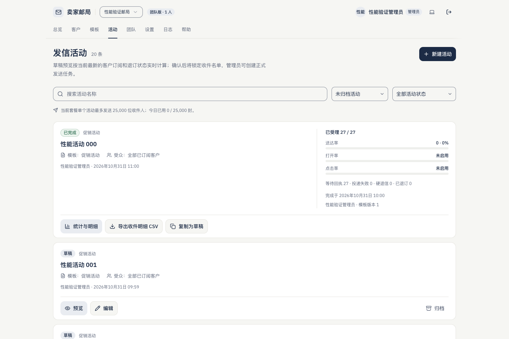
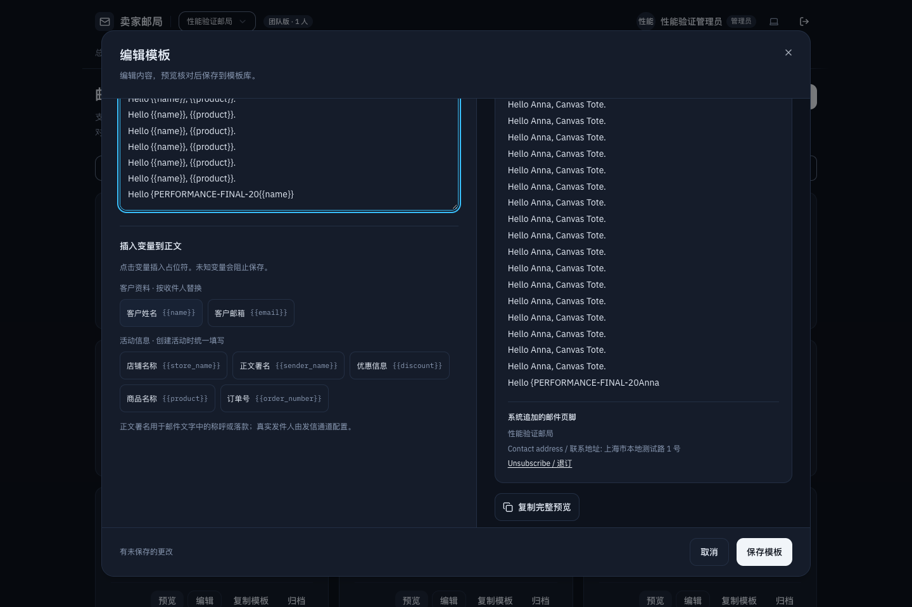
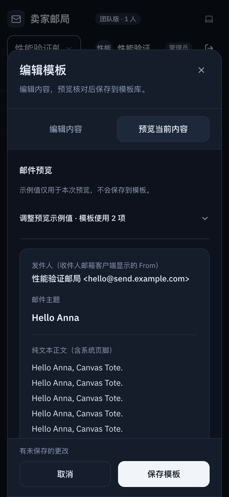
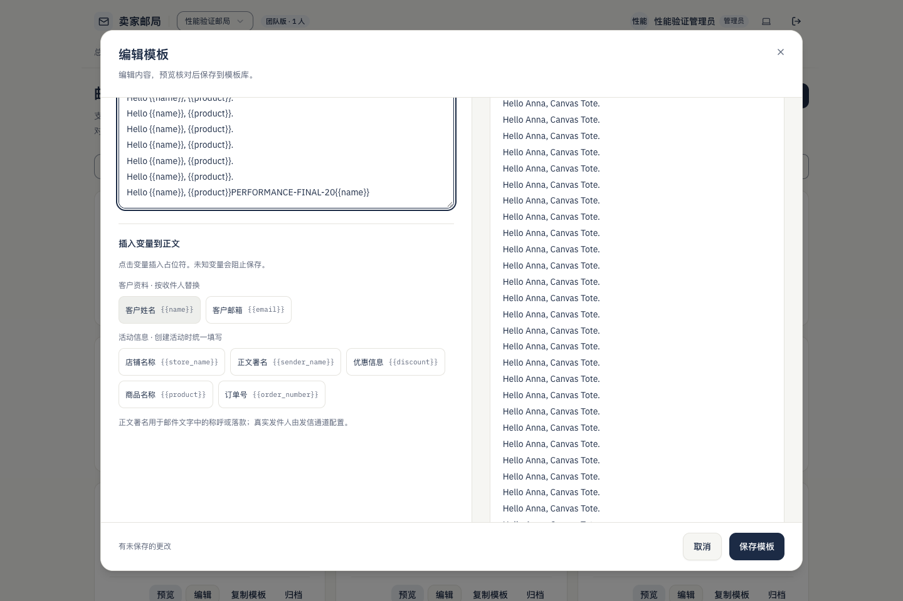
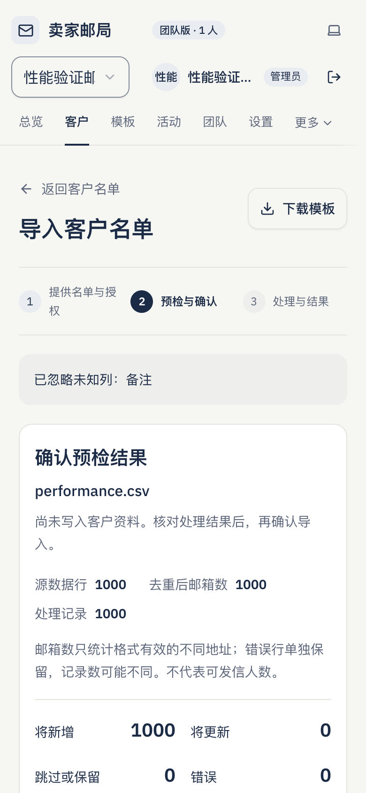

# 前端性能测量与针对性优化

日期：2026-11-01。分支：`codex/frontend-performance`。范围：活动、模板编辑器、客户导入，以及它们实际加载的共享外壳、依赖与字体。

## 证据范围与结论

本轮用本地 `next build` / `next start` 产物测量，没有把开发服务的编译、HMR 或默认 E2E 等待当成性能收益。页面与业务数据来自隔离认证夹具和 PGlite，未连接线上客户、真实支付或邮件服务商。

选中的改动是活动预览请求调度、模板输入时的列表执行，以及测量中发现的活动分页兼容性修复。没有新增依赖、数据库迁移、公共缓存、生产监控或第三方分析 SDK；邮件正文、变量替换、发送校验与统计口径沿用原实现。

完整五次数据、运行时源码指纹、浏览器条件和逐项波动会随本文保留在 `images/frontend-performance/`。本地日志和完整 Chrome 轨迹放在独立 `.impeccable/frontend-performance/`，不会被默认 Playwright 报告清理，也不整体提交到 PR。

## 版本与可复现入口

- 原始产品基线：`13d9a291a016b5987777c60e3e1071c0f0153faa`。
- 可直接执行测量的基线提交：`d602f9f4d18d38a3ebd77997180adc118f99463b`。它只增加测量工具，运行时源码 SHA-256 与原始 `main` 一致：`1d21621009b64de3191432ba0eac7af875670a54bad74083703582500256b035`。
- 优化产物提交：`21eb16653d31a32141f0ef78906d5dc247e53716`。后续文档和证据提交不改变运行时源码。
- 依赖锁文件 SHA-256：`44178a4c414382eb796039fe6a2980bcd999dfc65f88d7582dabbf6c74871df5`。前后未安装、升级或移除依赖。

分别在对应提交的工作区执行，两个服务使用相同端口，须顺序运行。默认功能回归也使用 `54329`，应在性能服务退出后执行。

```sh
npm ci
npm run test:performance -- before
# 在优化提交的工作区运行，先复制基线 .impeccable/frontend-performance/before 到当前同名目录。
npm run test:performance -- after
npm run test:performance:compare
```

`test:performance` 自动构建生产包，再启动本地数据库夹具与 `next start --port 3110`。每次完整运行约数分钟，五次采样逐个执行；不会改变默认 `playwright.config.ts`、CI 工作流或默认开发服务。

独立诊断轨迹不混入五次统计：

```sh
EDM_PERF_SAMPLES=1 EDM_PERF_SIZES=boundary EDM_PERF_DEVICES=desktop \
  EDM_PERF_DIAGNOSTIC=1 npm run test:performance -- before-diagnostic
# 在优化工作区同条件运行 after-diagnostic，再重新执行 compare。
```

`EDM_PERF_SKIP_BUILD=1` 仅用于明确知道现存生产产物版本的诊断，不用于跳过正式构建。构建 ID、源码指纹和完整提交号均写入 `metadata.json`。诊断开关会增加轨迹开销，不能与未开轨迹的五次样本直接比较耗时。

## 固定条件与步骤

| 项目 | 条件 |
| --- | --- |
| 主机 | macOS / Darwin 27.0.0，Apple M5，arm64，Node 24.14.1 |
| 性能浏览器 | 本机 Chrome 156.0.8078.76，Playwright 1.63.0，无头运行 |
| 桌面 | 1440 × 960，DPR 1 |
| 手机模拟 | 390 × 844，DPR 2，`isMobile`、`hasTouch` 开启；仍是桌面 Chrome 引擎与默认 UA，不是手机实机 |
| CPU | CDP `Emulation.setCPUThrottlingRate`，4 倍减速；不是锁定频率的实体低端设备 |
| 网络 | CDP：延迟 40ms，下行 1.6Mbit/s，上行 750Kbit/s，无丢包 |
| 接口夹具 | 每次认证和数据请求固定等待 20ms，再执行真实本地 SQL / RLS；不模拟生产数据库、跨区链路或服务商延迟 |
| 角色与工作区 | 独立 `example.test` 管理员，Team 工作区；普通与边界账号分开，默认回归不启用性能夹具 |
| 冷缓存 | 每条路由、每次样本创建全新浏览器上下文，只复用隔离登录状态；没有 HTTP 资源缓存 |
| 热缓存 | 在同一上下文再次硬导航相同 URL；实际资源传输验证 JS / CSS / 字体命中缓存 |
| 首次与再次 | 热导航完成后，分别首次打开、关闭、再次打开编辑器、预览和统计；两次都保留在统计中 |
| 采样 | 2 种规模 × 2 种视口 × 5 次独立有效样本，前后各 20 个；每次含 3 条路由的冷、热硬导航与核心操作 |

每次先等待标题可见、主题按钮挂载、字体就绪和两帧，再完成固定操作。软导航另从活动进入模板、再回活动，不把它标成标准页面 LCP。

常规数据为 20 套模板、500 字固定正文、20 场活动，原有隔离客户加 20 位测试客户；可发送与统计任务为 27 位。边界数据为 50 套模板、20000 字正文、100 场活动、500 位客户；正式对照的活动页保持有效的 20 条页大小，模板使用允许的 50 条页大小。100 条活动分页错误另外作为兼容性缺陷验证，不把错误页与正常页比较速度。

模板输入以前置固定内容开始，近 20000 字时仍留出输入和变量插入空间；连续键入 20 字符，等待最后一次输入出现在预览，再插入 `{{name}}`，手机切换到可见预览。没有防抖或延迟预览。

导入分别使用 20 / 1000 行的同一生成规则。边界文件接近 2MiB，含合法邮箱、姓名和大段被原有解析器忽略的“备注”列；分别记录文件读取、名单文本替换、解析到预检结果可用。预检没有把客户改成已订阅，也不代表可以发送。

所有账号、邮箱、署名、通道凭据和统计均为本地测试值。统计状态由夹具构造，没有启动服务商发送进程。数据库生成的内部 UUID 不作为性能判定或截图文字，业务字段、顺序、规模和操作固定。

## 指标定义与归因边界

- `ttfbMs`：硬导航开始到响应首字节；包含本地服务处理与模拟网络等待。`documentTransferMs` 为文档响应阶段，不能等同于全部页面加载时间。
- FCP、LCP、CLS 来自浏览器原生 PerformanceObserver / Navigation Timing。LCP 只用于硬导航，CLS 排除最近用户输入触发的布局变化。
- `readyMs` 包含标题、主题挂载、字体、两帧和固定 150ms 观察窗，是本脚本的完成条件，不能称为标准可交互时间。字体后的其它异步工作不保证全部结束。
- 首屏资源按 CDP 实际完成传输计算，区分 Document、Script、Stylesheet、Font、Fetch 等；字节包含协议头及压缩后的传输成本。不是构建目录的总大小。网络瀑布保留请求路径、发起来源、先后关系、响应头等待与传输量，不保存认证头或正文。
- `ScriptDurationMs`、`LayoutDurationMs`、`RecalcStyleDurationMs`、`TaskDurationMs` 来自 CDP。加载使用当前文档累计值，交互取操作区间差值。脚本时间含启动、水合与业务执行，**没有独立量出水合耗时**。
- `observedMs` 是自动化发起操作至结果断言、两帧结束的完整观测，包含驱动、滚动、协议和等待开销；相关 DOM 首次变更反馈另记录 `feedbackMs`。后者是相关区域 DOM 变更后两帧的代理，隐藏预览的变更也可能被观察到，不能精确等同像素呈现或 INP。
- 输入帧观测从原生 `input` 捕获到第二次 rAF，保留每次输入的值；没有把它、单次点击或 Playwright 等待称为 INP。本轮没有计算真实用户 INP，也没有从五个样本估计 p75 / p95。
- 长任务保留实际开始、持续时间；`longtaskBlockingMs` 仅为本区间超过 50ms 的部分之和，不等同 Lighthouse TBT，更不等于 INP。
- 服务器请求时长包含固定 20ms、协议处理和本地 PGlite / RLS 执行；扣除 20ms 后仍不能称为纯 SQL 时间。生产服务端、数据库及服务商处理耗时均待真实环境另行确认。

首次 20 个样本曾放在默认 `test-results/`，被功能回归自动清理，因原始文件无法保留而整体退出正式统计。修复输出目录后，从固定基线提交完整重采；没有根据快慢排除某个有效样本。校准失败、单次属性探测及打开轨迹的诊断均不纳入五次数据。

## 瓶颈、取舍与预算

| 优先级 | 确认的问题 | 证据与处理 |
| --- | --- | --- |
| P2 | 活动预览客户端并发写法仍产生两次串行 Server Action | 浏览器网络瀑布和服务端夹具均确认；本地 Next 16.3.4 `server-actions.md` 明确客户端调度排队。改为一次受原权限校验保护的只读 Action，内部并行调用原有预览与详情 RPC，只返回所需署名，不额外传回详情正文 |
| P2 | 模板连续输入会遍历未变化的模板列表 | 页面状态与列表在同一组件，浏览器轨迹显示持续脚本执行。将原卡片结构原样移入 `TemplateGrid`，只在列表数据、权限、加载或操作状态改变时更新；编辑输入、校验和预览仍同步执行 |
| P1 | 50 / 100 条活动分页超过摘要 RPC 每次最多 20 个 ID 的限制 | 基线 100 条 URL 稳定进入错误页。按 20 个 ID 分批读取并统一检查错误；任一批次失败仍走原错误流程，没有返回不完整统计或放宽 RPC 限制 |
| P2，保留 | 大段名单文本替换产生明显长任务 | 自动化近 2MiB 输入的 EventDispatch / Layout 占主要等待，前端解析和接口另有独立区间。属性探测未提供足够收益证据，关闭换行会改变既有阅读方式；保留原行为与完整文本，记录剩余问题 |

预算依据基线设置：活动预览应减少一次实际浏览器请求，并使首次、再次预览的中位等待低于原有效范围；模板应消除可确认的不变列表执行，同时以五次脚本数据、预览同步与完整操作范围约束收益；不能预先承诺整体输入速度。首屏资源、首次打开与再次打开作为约束一起比较，不能把成本挪到首次使用后宣称改善。具体实测值见后面的五次对照。

没有采用：全局缓存、叠加 `getContext` 缓存、动态加载弹窗、Worker、防抖、延迟预览、虚拟列表、字体子集或新预加载。原因分别是现有请求级缓存与工作区清理已经存在、未定位到值得转移的模块成本、原生大文本编辑成本不能靠解析 Worker 消除、现有分页可以控制 DOM，以及字体的实际请求与字符覆盖没有支持删减的证据。

共享外壳、QueryClient 的工作区 / 退出清理、角色限制与发信确认均保留。套餐读取确有重复接口调用，但在当前页面并行区间内不是最大等待，本轮没有为消除函数调用数量再增加缓存。

## 回归与证据边界

针对性 17 项已通过：活动草稿、动态变量、名单预览、确认保护与权限，模板保存、示例值边界、未保存离开保护、错误保留、手机预览和键盘收缩，客户导入互斥、失败与恢复。新增实际浏览器回归覆盖 50 / 100 条活动分页、过滤结果、预览仅一次 POST、详情读取失败不阻塞预览、再次打开和焦点恢复。

没有引入动态模块或新的异步输入调度，因此没有新增模块加载 / 重试或最后一次输入提交同步问题。原有失败、关闭、迟到响应序号、未保存保护、焦点和工作区组件 key 均继续生效。没有改动正式发送前校验、自动重试、副作用幂等、订阅状态、去重、批次、配额和套餐规则。

本轮源代码复核、实验室测量、自动化浏览器截图和远端检查分别记录。真实 iPhone / Android、真实 Safari、原生软键盘、读屏软件、生产网络和真实服务商尚未验证；Playwright WebKit 不代表真实 Safari。没有线上 Core Web Vitals 或真实用户体验已改善的声明。

Supabase 调用形态已对照[官方 RPC 文档](https://supabase.com/docs/reference/javascript/rpc)与安装版本类型核验；本轮没有共享 Supabase 配置、Auth、迁移、`aigc` 或其他项目资源变更。

## 五次正式对照

下表单位为 ms，格式为“中位数（最小值–最大值）”，每格 **n=5**。只在同一规模、设备、操作之间比较；所有有效慢样本都保留。广覆盖前后各 20 个样本，模板独立复测前后各 5 个，完整 CSV 流程前后各 20 个，合计前后各 45 个；profiling / 轨迹各一次另列。

### 活动预览

| 条件与操作 | 基线 | 修改后 |
| --- | --- | --- |
| 常规 / 桌面 / 首次预览 | 511.8（476.9–752.5） | 346.1（331.9–407.9） |
| 常规 / 桌面 / 再次预览 | 522.6（446.9–644.4） | 342.7（328.7–357.2） |
| 常规 / 手机模拟 / 首次预览 | 479.2（470.0–508.7） | 334.8（328.1–369.2） |
| 常规 / 手机模拟 / 再次预览 | 450.5（431.1–494.7） | 315.9（301.4–346.2） |
| 边界 / 桌面 / 首次预览 | 503.9（374.7–597.1） | 367.0（357.6–381.5） |
| 边界 / 桌面 / 再次预览 | 449.2（375.4–581.6） | 360.7（359.4–399.9） |
| 边界 / 手机模拟 / 首次预览 | 524.4（409.0–671.7） | 378.9（354.1–402.6） |
| 边界 / 手机模拟 / 再次预览 | 496.2（396.2–772.2） | 365.2（347.8–379.3） |

每次预览的浏览器 POST 从 **2 → 1**；夹具请求从 **12 → 7**，两项原有只读业务 RPC 均保留，认证和工作区检查在同一个请求内复用现有上下文。前后都先显示原预览加载反馈，关闭、重开和迟到响应序号不变。收益来自消除客户端动作队列的一次往返和重复上下文读取，不是缓存预览或删除校验。

### 模板输入与可见预览

| 条件 / 20 字符输入 | 基线总观测 | 修改后总观测 |
| --- | --- | --- |
| 常规 / 桌面 | 679.1（656.0–680.9） | 608.8（565.3–647.7） |
| 常规 / 手机模拟 | 612.4（596.6–626.4） | 582.2（555.9–613.6） |
| 边界 / 桌面 | 855.6（719.5–1118.9） | 982.5（830.8–1128.2） |
| 边界 / 手机模拟 | 690.0（570.1–1440.9） | 860.4（624.9–955.0） |

广覆盖样本中的边界桌面、手机总耗时中位数上升，不能据此声称所有输入场景更快。对边界桌面追加独立五次复测，只有模板路由，排除其它流程先后造成的内存与执行状态差异：

| 独立复测指标 | 基线 | 修改后 |
| --- | --- | --- |
| 20 字符输入至预览同步 | 1092.5（812.0–1333.1） | 1066.9（868.9–1240.8） |
| 相同区间脚本时间 | 256.8（158.2–353.7） | 195.5（129.2–247.2） |
| 相同区间布局时间 | 332.5（227.5–443.2） | 360.4（261.5–443.4） |

这组总耗时差异较小且范围重叠，**不宣称可感知输入提速或边界总耗时已稳定下降**。可确认的收益是减少列表的重复执行；20k 正文的原生输入、文本布局和预览更新仍占较多成本。首轮“整体输入观察值明显下降”的预算未在所有边界组达成，剩余差异的细粒度来源待更稳定的主机 / 真机环境确认。

使用独立 `next build --profile` 的提交记录定位实际执行次数（每组一次，非五次性能结论）：

| 20 字符输入区间 | 基线执行次数 | 修改后执行次数 |
| --- | ---: | ---: |
| Templates | 20 | 20 |
| 模板 Card | 1000 | 0 |
| 模板 CardContent | 1000 | 0 |
| TemplatePreview | 20 | 20 |

工具只在测试浏览器安装 React DevTools 提交钩子，针对当前锁定 React 19.2.8 识别已注册组件，按 `actualStartTime` 排除旧子树，统计已提交的执行；不覆盖被丢弃的渲染，不进入产品、普通构建或五次测量。嵌套 `actualDuration` 含子树，不能相加或外推总体百分比。完整识别范围和数值见 [react-profile-summary.json](images/frontend-performance/react-profile-summary.json)。

同一次定位还确认：活动预览与统计的 Campaigns 提交执行均为 2 → 2；导入首批结果的 ContactImporter 为 3 → 3、ContactImportResults 为 2 → 2。大段同值文本替换的 ContactImporter 为 0 → 0；此压力操作的长任务不能归咎于 React 重复渲染。

### 导入完整任务与剩余长任务

广覆盖的 `import-prepare-result` 只等到首批预检结果可见，不能称为所有计数完成。为补齐完整任务，另做前后各 20 个 CSV 样本：从传入文件开始，到当前结果页、摘要及完整去重邮箱计数可用。使用相同 20 / 1000 行和内容生成规则，边界文件为 **1,843,797 字节（约 1.76MiB）**；没有缩减数据来获得更好结果。

| 完整 CSV 任务 | 基线 | 修改后 |
| --- | --- | --- |
| 常规 / 桌面 | 354.1（330.7–361.3） | 362.9（339.6–380.3） |
| 常规 / 手机模拟 | 328.9（328.1–346.1） | 356.8（329.1–406.8） |
| 边界 / 桌面 | 1761.6（1759.7–1763.1） | 1988.5（1883.3–2279.1） |
| 边界 / 手机模拟 | 1778.5（1745.2–1814.0） | 2125.0（2062.3–2323.9） |

**导入没有产品代码优化，也没有提速结论。** 后测完整任务变慢：边界桌面文件传入中位数约 325 → 470ms，预检至全部计数约 1429 → 1504ms；其中夹具 `prepare_contact_import` 请求约 79 → 106ms（含固定 20ms）。主机调度、驱动传入文件与本地处理都存在波动，不能把全部差值归因到前端代码或生产数据库。

原生文本压力操作仍有秒级长任务。它是在文件内容已经显示后执行同值整段替换，包含自动化的选择与输入成本，**不是用户首次粘贴或 INP 的估计**。关闭拼写检查、关闭换行、增加 containment 的单次探测不能支撑稳定收益，且关闭换行会改变阅读方式，所以均未进入产品。近 2MiB 文本、真实手机输入法及最大套餐名单仍是后续性能验证范围；统计使用 500 位受控客户，未覆盖 Team 最大允许名单。

### 加载、资源与成本转移

下列为常规桌面硬导航的实际传输中位数（字节，n=5）。

| 路由 | JS 前 → 后 | CSS 前 → 后 | 字体前 → 后 |
| --- | ---: | ---: | ---: |
| 活动 | 268980 → 268945 | 20028 → 20069 | 90320 → 90320 |
| 模板 | 257605 → 259363 | 20484 → 20525 | 65768 → 65768 |
| 导入 | 267336 → 267334 | 20919 → 20960 | 105328 → 105328 |

模板首屏 JS 增加 **1758 字节，约 1.72KiB**，这是增加组件边界的明确代价；共享 CSS 增加约 41 字节。字体下载不变，保留原字形、字重、字符范围和回退，没有新增预加载。没有把构建目录总大小当路由实际下载量，也不宣称首屏包体优化。

所有路由热导航的静态 JS / CSS / 字体实际传输均为 0；动态 HTML、权限与业务请求仍发生。没有新增懒加载、输入调度、公开缓存或离线缓存，所以不存在新增的首次模块下载等待。首次 / 再次编辑器、统计和预览，以及软导航的完整五次数据均保留在 JSON 中；没有只选再次打开。

| 冷导航 LCP | 基线 | 修改后 |
| --- | --- | --- |
| 常规 / 桌面 / 活动 | 1188.0（1056.0–1252.0） | 1044.0（924.0–1056.0） |
| 常规 / 桌面 / 模板 | 1080.0（788.0–1192.0） | 744.0（720.0–1044.0） |
| 常规 / 桌面 / 导入 | 1116.0（1040.0–1224.0） | 780.0（736.0–1052.0） |
| 常规 / 手机模拟 / 活动 | 1028.0（800.0–1044.0） | 1056.0（1032.0–1076.0） |
| 常规 / 手机模拟 / 模板 | 728.0（716.0–748.0） | 752.0（700.0–1000.0） |
| 常规 / 手机模拟 / 导入 | 772.0（748.0–1052.0） | 1028.0（820.0–1032.0） |
| 边界 / 桌面 / 活动 | 1016.0（668.0–1096.0） | 1060.0（828.0–1112.0） |
| 边界 / 桌面 / 模板 | 984.0（956.0–1044.0） | 1112.0（1044.0–1196.0） |
| 边界 / 桌面 / 导入 | 732.0（664.0–1220.0） | 1020.0（784.0–1032.0） |
| 边界 / 手机模拟 / 活动 | 1124.0（688.0–1132.0） | 1076.0（820.0–1100.0） |
| 边界 / 手机模拟 / 模板 | 1108.0（972.0–1440.0） | 1068.0（1044.0–1144.0） |
| 边界 / 手机模拟 / 导入 | 1072.0（636.0–1108.0） | 1056.0（768.0–1140.0） |

冷热加载的 TTFB、FCP、LCP、CLS、静态与预取资源、脚本 / 样式 / 布局及请求数，见 [comparison.json](images/frontend-performance/comparison.json) 与 [measurements.json](images/frontend-performance/measurements.json)。加载变化有升有降，包含未改动的导入路由，**不将它们归因为本轮加载优化或线上 CWV 改善**。

`budget/*` 是相邻阶段的观测值相加，仅作为成本预算，不是连续用户任务耗时；活动冷导航和首次预览也没有被伪装成一次连续端到端采样。实际操作区间和 CSV 连续任务分别列出，软导航始终不叫页面 LCP。

[waterfalls.json](images/frontend-performance/waterfalls.json) 保留代表样本的浏览器与夹具请求顺序；[trace-summary.json](images/frontend-performance/trace-summary.json) 保留同条件 profiling 生产构建的阶段轨迹，解释脚本与原生输入 / Layout 的成本。各类 trace 事件有嵌套，不把所有 duration 求和当 CPU 时间。profiling 构建与轨迹的开销不混入普通生产包的五次结果。

## 补充复现与工具版本

基线 `d602f9f` 的工具支持广覆盖入口。补充实验需要将本 PR 的 `tests/performance/` 复制到新建的基线工作区，仅更新测试工具，不改 `src` / 配置 / 锁文件；工具会核对对应运行时源码指纹、依赖、Chrome 和限制参数。前后分别执行下列命令，再将 before 目录复制至优化工作区的 `.impeccable/frontend-performance/`，最后运行 compare：

```sh
# 在基线工作区使用 before 前缀；在优化工作区使用 after 前缀。
EDM_PERF_SAMPLES=5 EDM_PERF_SIZES=boundary EDM_PERF_DEVICES=desktop \
  EDM_PERF_ROUTES=templates npm run test:performance -- before-focused-template
EDM_PERF_SAMPLES=5 EDM_PERF_ROUTES=contacts/import EDM_PERF_IMPORT_FILE_FLOW=1 \
  npm run test:performance -- before-complete-import
EDM_PERF_SAMPLES=1 EDM_PERF_SIZES=boundary EDM_PERF_DEVICES=desktop \
  EDM_PERF_REACT_PROFILE=1 EDM_PERF_DIAGNOSTIC=1 \
  npm run test:performance -- before-react-profile
npm run test:performance:compare
```

每阶段夹具重新初始化；同阶段导入预检草稿历史按样本顺序累积，前后使用相同顺序。浏览器上下文逐次独立，不假装数据库每次都清空。参考 [supplemental.json](images/frontend-performance/supplemental.json) 的每个样本与分阶段接口处理时间，不混合不同采样批次来挑最快值。

## 同状态视觉对照与工程验证

以下均为本地脱敏数据的原始 PNG。五组同状态前后文件 SHA-256 完全一致；像素一致只证明这些代表状态没有视觉变化，不能替代功能、无障碍或全部设备验收。

| 状态 | 基线 | 修改后 |
| --- | --- | --- |
| 桌面活动，浅色 |  |  |
| 桌面模板，深色 |  |  |
| 手机模板预览，深色 |  |  |
| 桌面近 20k 正文，浅色 |  |  |
| 手机导入，完整计数就绪 |  |  |

计数加载中的独立状态也已保留：[实际加载截图](images/frontend-performance/import-count-loading-after.png)。它不与计数完成的图片伪装成同状态比较。图片及源代码指纹、detector 结果见 [evidence.json](images/frontend-performance/evidence.json)。实际查看了桌面编辑、手机深色预览、活动统计卡和导入结果原图；属于截图复核，不是手动真机或读屏操作。

- 针对性回归：17 项通过，包括本轮新增的 2 项真实浏览器回归。
- 响应式专项：15 项通过；Chrome 156.0.8078.76、Firefox 155.0、Playwright WebKit 26.6，各 113 个场景，共 339 个；另有既有断点、短视口、文字放大、键盘收缩和自然回流断言。记录见 [responsive-summary.json](images/frontend-performance/responsive-summary.json)。
- 视口含 320 / 390 / 820 / 1440px，明暗主题、长名称、复杂弹窗与根字号模拟；没有把 CSS 根字号放大当作原生缩放或真实输入法。
- Impeccable 在最终三个改动 UI 文件上只扫描一次，结果 `[]`。没有新增字体、颜色、圆角、控件尺寸或忽略规则；DESIGN.md 不需要因本次性能代码组织更新。

本轮技术抽查评分：可访问性 3/4、性能 2/4、主题 3/4、响应式 3/4、实现一致性 3/4，合计 14/20。评分只覆盖本轮表面，保留现有键盘 / 焦点 / ARIA 与品牌规范；性能仍受边界原生输入、布局及实验室波动限制，不作为全站合规认证或线上结论。

`npm run ci:verify` 已完整通过：lint、typecheck、format:check、222 项单元 / 数据库测试、生产构建、64 项 E2E；1 项按默认条件跳过（无加密密钥专项，默认配置提供测试密钥）。预推送仍执行仓库 `pre-push` 的完整 `ci:push`，没有跳过 hook。

GitHub「工程验证」与 Vercel 预览属于独立远端结果，以最终 PR head 的实际检查为准；本地通过不代表远端通过。真实设备、线上数据与真实发信均未验证。

产品源码变化限定在活动 Actions / 客户端，以及模板列表组件和稳定回调；导入、字体、Providers、认证、工作区缓存清理、模板渲染模型和发送校验无产品源码改动。其它提交为独立测量工具、固定夹具、两项浏览器回归和本验收证据。最终交付提交的运行时源码与 `21eb166` 一致，构建和比较元数据保留了完整指纹。
