# 首次使用引导：流程与验收

日期：2026-10-31。基线：`origin/main` 的 `8a267cff99928b135e47c8c1098a98e092e13208`。本轮模式为 Operate，沿用暖灰、深蓝、Fraunces / IBM Plex 和现有共享组件。

## 目标与现状依据

面向首次使用邮件营销工具的中文个人卖家、小团队和工作室，让用户从总览理解准备顺序，完成必要配置，创建第一场活动、预览邮件并确认名单。正式发送仍由管理员按原流程明确确认。

收尾时 main 已合入 PR #84（通道弹窗滚动分区修复），本轮提交已无冲突重放到 `8b4c8c2ff556e62be4b52b7a336142b5fff72808`。基线图仍保留修改前 `8a267cf` 的真实来源；#84 涉及的通道表单、样式和键盘用例不混入本 PR 的变更范围，最终兼容回归在最新基线上执行。

已实时核对 PR #79（活动）、#80（模板）、#81（导入）、#82（通道）、#83（手机通道操作栏）均已合入 main；本轮复用其当前实现，不依赖未合并 PR，不重复制作表单。`/onboarding` 继续自动初始化，总览继续承担准备引导，帮助中心继续承担说明。

改前先在当前代码上采集 64 个基线场景，再进行 UI 修改。impeccable 的设计评审 A 与检测／可视证据评审 B 使用两个独立代理，A 完成后主任务才读取 B。A 的启发式评分为 24/40，B 的静态检测为 0 项；静态无命中不能证明任务路径清楚。

主要问题与选择：

| 问题与证据 | 最终处理 | 选择理由 |
| --- | --- | --- |
| 新工作区先展示四张指标，390px 下任务和主操作位于首屏较后位置 | 没有活动时，准备区域在指标之前；已有活动时，日常概况优先 | 首次任务与回访任务不同，DOM 与视觉顺序一致 |
| “下一步”实际是平行待办，主按钮固定为“查看活动” | 推荐一个当前有权限的待办，保留所有准备项与自由调整入口 | 提供开始点，同时保留先建草稿的选择 |
| 完成项消失，默认署名混入基础条件 | 四项准备保留已完成／待完成／待核对，署名单独作为建议 | 完成状态可识别，建议项不冒充硬性条件 |
| 角色收到相同任务 | 管理员负责身份和通道；运营优先准备客户、模板和活动；查看者看到只读说明 | 避免把用户引向无权限写入操作 |
| 任一查询失败会抹掉总览 | 独立读取结果，失败区域显示待核对和重试，保留其他入口 | 未知不等于空、不等于完成 |
| 跨页任务缺少接续 | 用 `guide` 查询参数显示当前任务、返回清单与继续入口；复用设置锚点 | 不重复造表单，不另建业务状态机 |

没有创建 PRODUCT.md / DESIGN.md，也没有重定义产品视觉。按本轮连续授权完成 critique → onboard → harden → clarify → layout/adapt → polish，没有逐阶段要求再次确认。

## 最终流程与状态来源

推荐顺序是店铺身份与页脚地址 → 主发信通道 → 已订阅客户 → 可用模板 → 活动草稿 → 预览邮件与确认名单。用户可自由选择顺序；现有预置模板可直接用于准备草稿，不要求重复创建模板。

| 展示事实 | 来源与含义 | 不代表什么 |
| --- | --- | --- |
| 页脚地址已准备 | 当前工作区地址非空，且通过现有占位文本检查 | 不额外验证邮政真实性，不改变正式发送的现有校验 |
| 主通道已验证 | 当前主通道 `status=verified` 且 `credential_configured`；说明复用 `channelSetupCopy` | 配置仅保存时不计完成；验证、服务商接收不等于送达或已读 |
| 已有已订阅客户 | 未归档客户查询与 `subscription=subscribed` 查询 | 添加／导入成功不等于订阅；仍可能被活动条件或防打扰规则排除 |
| 已有可用模板 | 当前未归档模板数量，包含初始化提供的 6 套默认模板 | 不表示已人工审阅本次内容或变量；归档模板不计入 |
| 基础准备完成 | 上述四项当前事实均满足 | 不包含个人署名，不包含某活动的名单、额度和正式发送资格 |
| 活动已创建 | 当前未归档活动列表的真实数量 | 不推断邮件已预览，也不推断名单已确认 |
| 预览与确认名单 | 引导提供现有活动页入口，实际行为仍使用原预览、确认与快照流程 | 点击入口不算完成；不保存“已看过”业务进度 |
| 已确认、发送与投递结果 | 最近活动保留现有活动状态与发送流程 | 名单确认不会立即发送，服务商接收也不代表最终送达 |

四项完成数仅统计能确认的完成事实，不展示“整个首次使用已完成”的虚构百分比。客户、模板、通道或活动读取失败时分别显示待核对；统计、日志、成员或套餐读取失败有独立说明和重试，不将故障误解释为免费套餐或空数据。

### 页面衔接与回访

- 总览准备项定位到现有设置锚点、客户导入／客户列表、模板和活动页。
- `guide=store/channels/contacts/templates/campaigns` 只控制上下文提示；参数白名单与路径匹配，不改变接口、鉴权或数据。
- 导入预检更新任务 URL 时保留 `guide=contacts`；导入结果、模板保存和原有离开保护继续复用。新提示没有跳过未保存保护。
- 通道验证后的返回入口定位到总览准备清单。正文署名不再决定是否展示“前往创建活动”这个导航入口；正式发送与模板变量的原校验不变。
- 稳定入口是总览的“查看准备清单”和帮助中心首次使用章节的“查看总览准备清单”。通过 `#onboarding` 返回时展开清单。
- 已有活动时默认收起，日常概况和最近活动仍易于访问。明确保存过的展开偏好继续生效；配置失效后完成数按最新业务数据下降，不保留旧完成标记。

展开偏好键为 `pixel-edm:onboarding:v1:<账号>:<工作区>:<角色>`，只保存 `expanded` / `collapsed`。不保存名单、邮件、凭据或业务完成状态；仅当前浏览器有效，不宣称跨设备同步。存储不可写时使用本次会话内的展示降级，仍能展开、收起。切换账号、工作区、角色会重置对应组件实例并使用独立偏好。

运营的展示入口同时考虑当前套餐席位状态；套餐不可读取时显示权限待核对。这个小范围共享判断仅用于引导展示，实际写入权限始终由原 Server Action、RPC 和数据库检查。

## 修改范围与兼容边界

- 主改动：总览、初始化提示、独立的准备状态展示模块和样式、AppShell 的条件式上下文帮助、帮助中心首次使用内容。
- 必要衔接：通道结果返回清单、正文署名的建议边界、导入 URL 保留引导参数。
- 初始化副作用增加单次自动提交保护，避免开发模式重复执行 effect 时，在第一次失败后又自动提交；手动重试、初始化 RPC、认证及跳转规则保持原流程。回归核对重复进入仍只有一个个人工作区。
- 不增加数据库迁移、分析服务、埋点、演示客户或新的业务状态。没有修改共享 Auth、aigc、其他项目资源或线上配置。
- 未修改订阅、防打扰、名单确认、正式发送校验、通道验证、凭据加密、幂等、额度、套餐与统计计算。
- `.prettierignore` 排除 `.impeccable/`，避免全量格式化改写原有未跟踪证据；本轮代表性截图单独提交到本目录。
- 既有 Next.js 本地 Server/Client 与查询参数文档已在写代码前阅读；新增客户端查询参数组件置于 Suspense 内。

## 前后对照

以下图片均为本地隔离测试账号、相同场景／主题／宽度的 Chrome 截图。图片是原始截图，不含真实客户数据；完整 64 对画面保留在本轮本地证据目录。提交的代表性图片及其哈希位于 `docs/images/onboarding/` 与 `evidence.json`，不依赖本机临时路径。

### 新工作区：桌面

改前任务与指标等权，主操作没有指向当前准备；改后任务领先，已完成模板可见，并保留先创建草稿的入口。

| 改前，1440px 浅色 | 改后，1440px 浅色 |
| --- | --- |
| 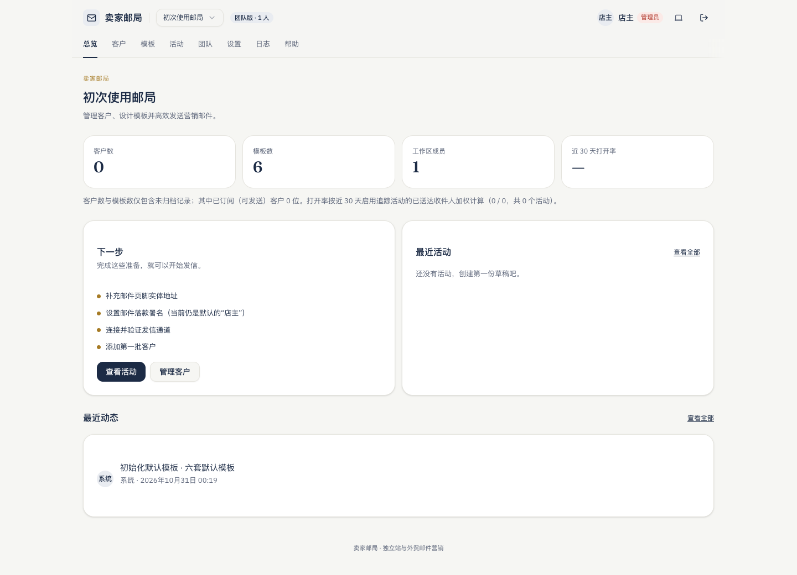 | 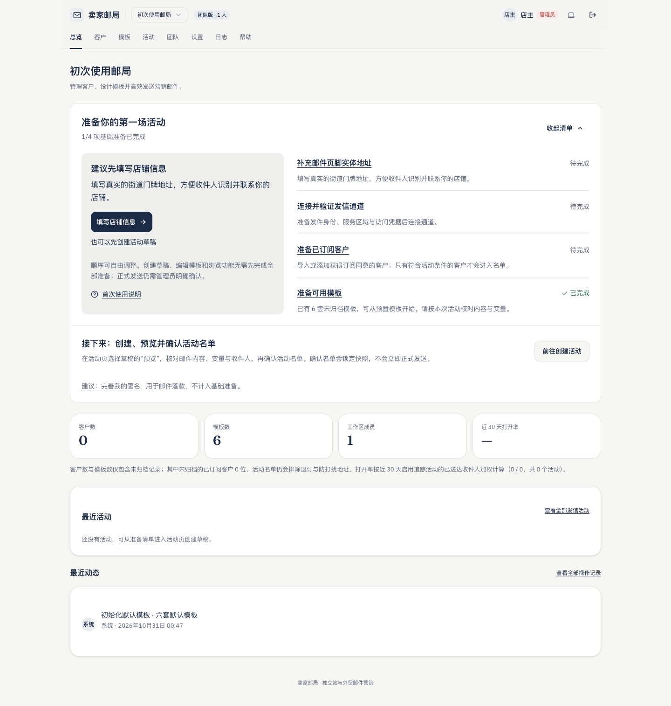 |

### 新工作区：手机

首屏可找到推荐操作，任务自然单列滚动，不新增粘性引导层。

| 改前，390px 浅色 | 改后，390px 浅色 |
| --- | --- |
| 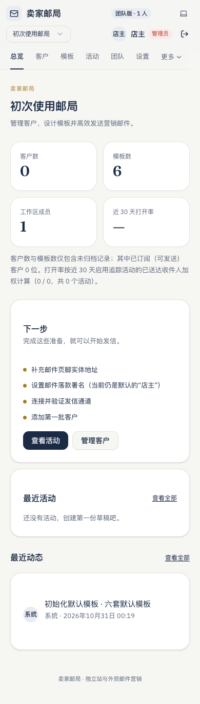 | 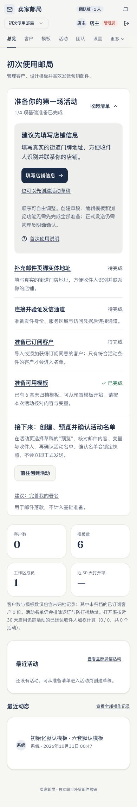 |

### 准备完成、回访与角色

| 场景 | 改前 | 改后 |
| --- | --- | --- |
| 基础准备已齐，仍用默认署名 | 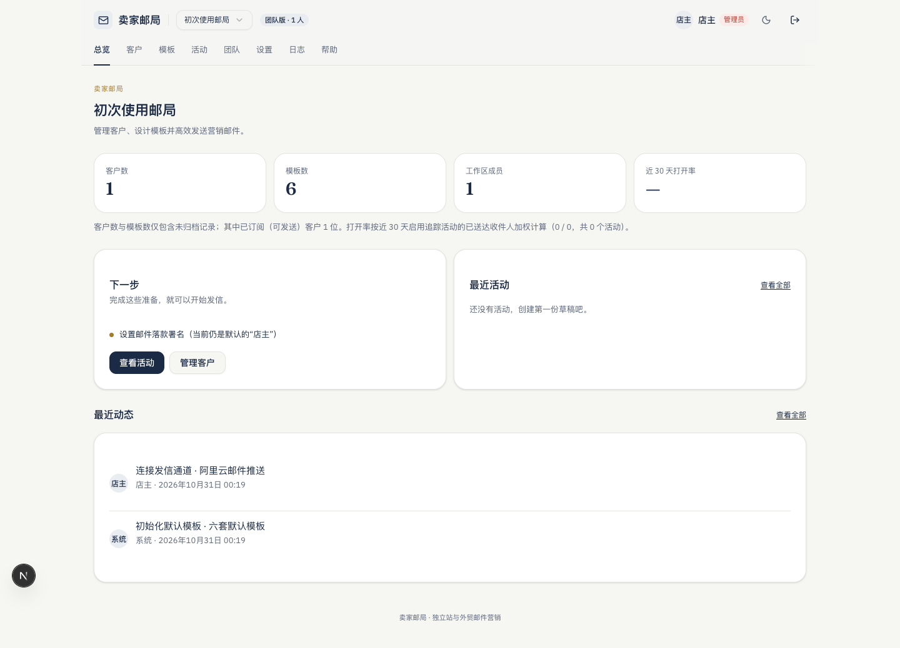 | 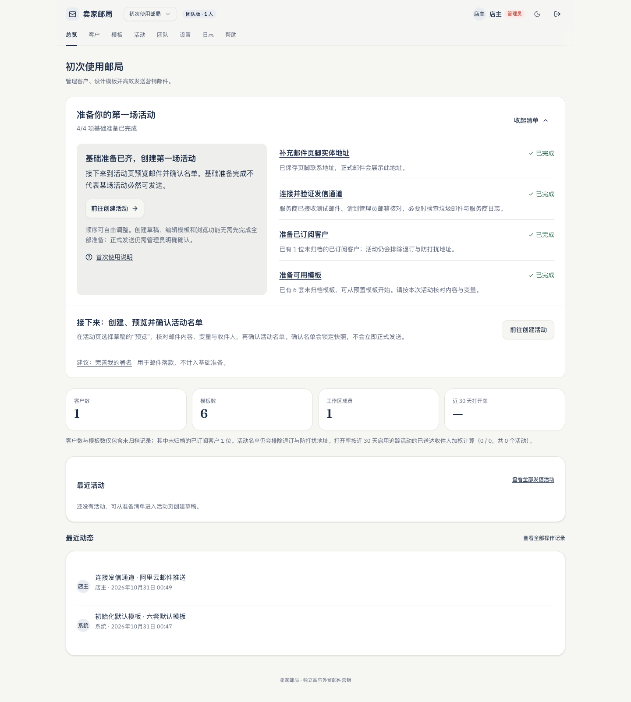 |
| 已有活动，390px 深色 | 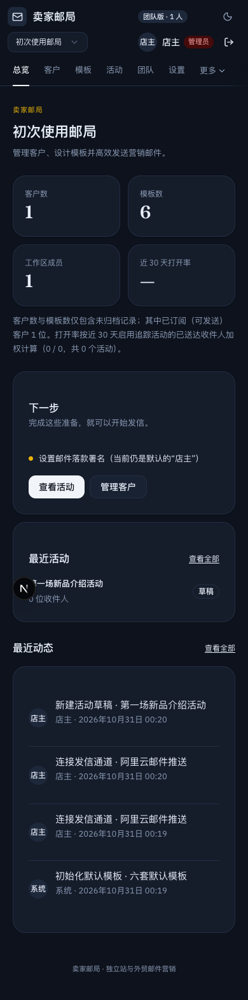 | 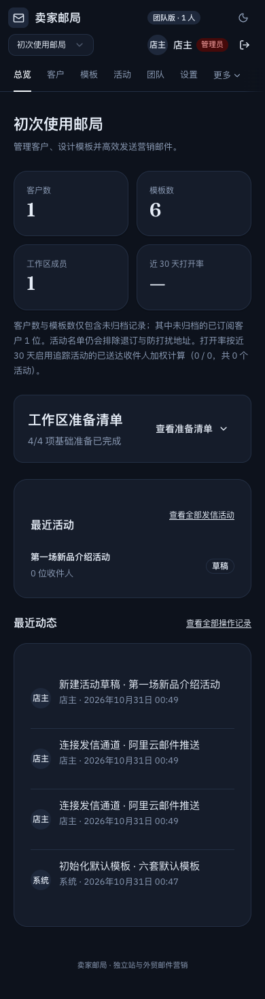 |
| 查看者，390px 浅色 | 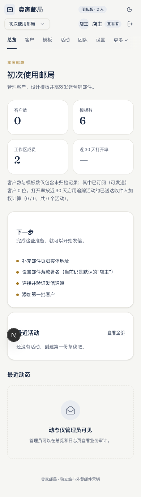 | 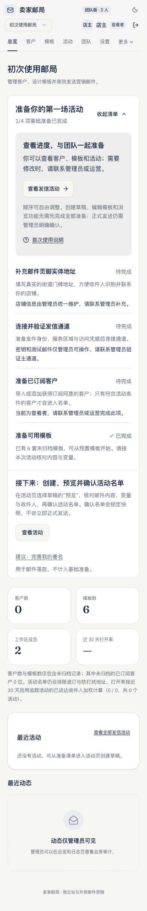 |
| 有客户但未订阅，390px 浅色 | 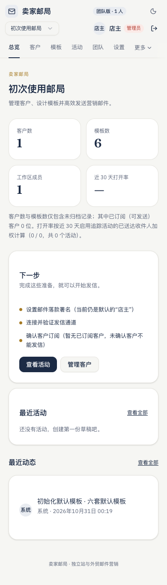 | 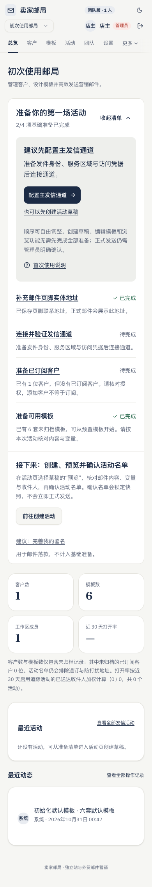 |

### 边界与完整路径

| 场景 | 修改后证据 |
| --- | --- |
| 数据读取失败，390px 深色 | 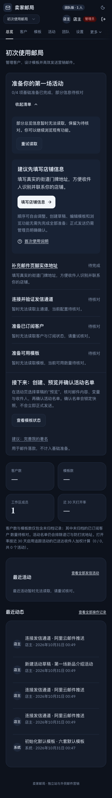 |
| 80 字工作区名与运营权限，320px 浅色 | 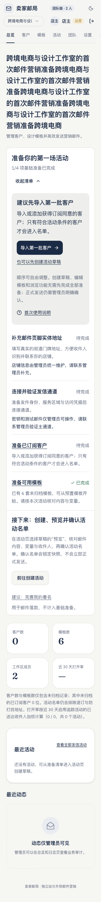 |
| 通道失效且模板已归档，820px 深色 | 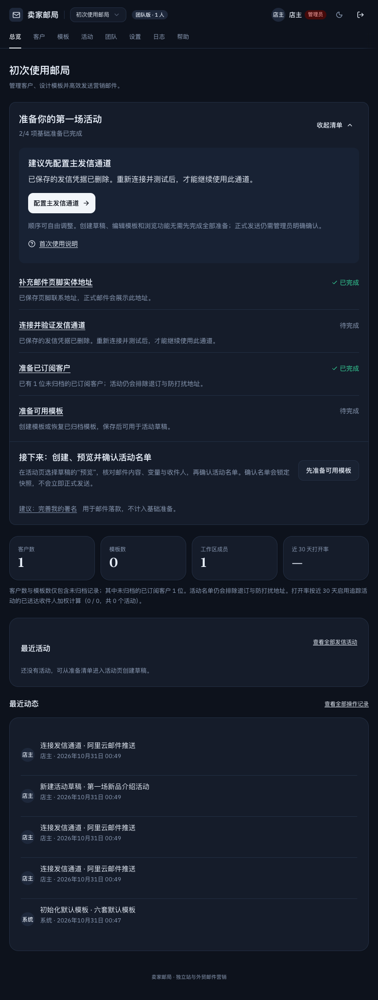 |
| 390px 导入处理完成，保留上下文帮助 | 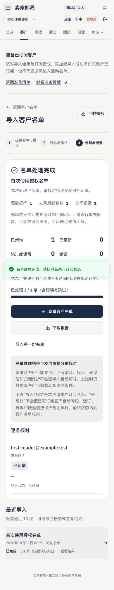 |
| 390px 预览邮件与收件人 | 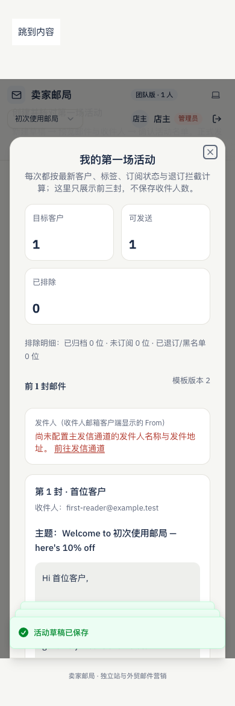 |
| 1440px 已锁定名单，仍需另行正式发送 | 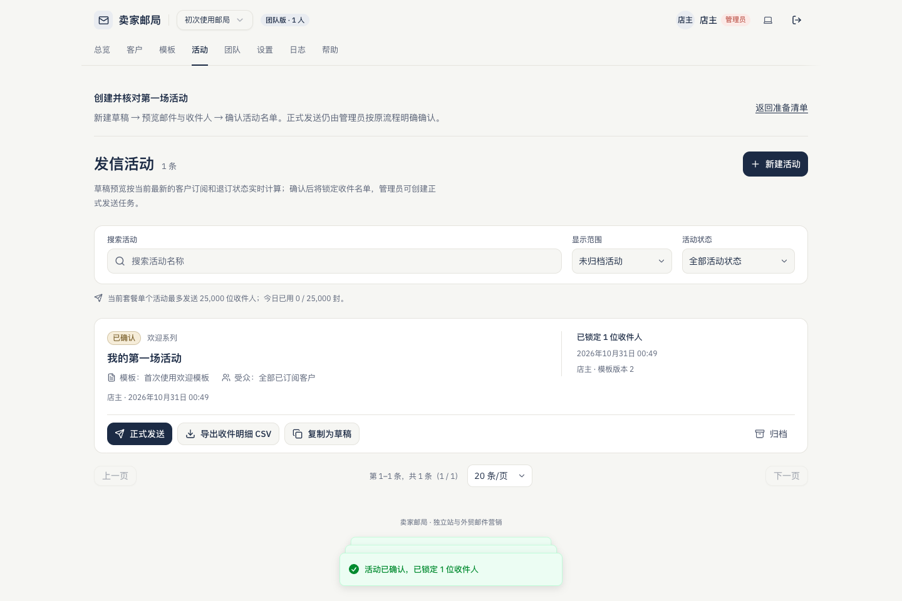 |

## 回归与实际结果

专项状态单测：`node --test tests/onboarding.test.mjs`，8 项通过。

专项交互与视觉：`EDM_ONBOARDING_VISUAL_PHASE=after npx playwright test tests/e2e/onboarding.spec.ts tests/e2e/onboarding-visual.spec.ts`，10 项通过（9 项交互、1 项视觉矩阵）。

覆盖的交互包括：

- 自动初始化失败、手动重试、原跳转、幂等工作区数量；
- 从空工作区的推荐首步保存地址，真实走完本地名单导入、模板保存、草稿创建、邮件预览与名单锁定；1440px 主要操作用键盘激活，390px 使用浏览器点击模拟；
- 地址或客户完成后返回总览更新，准备完成后通道断开回退，客户未订阅和模板归档边界；
- 多数据源读取失败不计空、不计完成，重试后恢复，统计或日志失败不抹掉准备状态；
- 管理员、运营、查看者、席位超限运营；
- 收起／展开、键盘焦点、回访、帮助入口恢复，以及账号／工作区／角色隔离；
- 浏览器存储不可写、80 字长名称、390×420 短视口与 200% CSS 缩放模拟；
- 确认活动名单后，主通道未验证时，即使输入完整活动名仍不能创建正式发送任务。

完整 `EDM_ONBOARDING_VISUAL_PHASE=after npm run ci:verify` 已通过：lint、类型、格式、222 项单元／数据库测试、生产构建、51 项 E2E。默认配置跳过 1 项无加密密钥用例；另用 `EDM_CHANNEL_NO_KEY=1 npx playwright test --config tests/channel-no-key.config.ts` 独立补验，1 项通过。推送前另执行 `npm run ci:push`，并保留 pre-push hook。

视觉测量：320／390／820／1440px × 明暗主题 × 8 种场景，共 64 个修改后场景。实测最大横向溢出为 0px，引导控件最小高度 44px、最小宽度 90px，文本计算对比度最低约 5.14:1；逐场景数据由 `evidence.json` 记录。新区域的控件要求至少 44×44px，普通文本计算对比度要求至少 4.5:1；数值通过后才列为验收通过。原生 `hidden`、`aria-expanded`／`aria-controls`、`role=status`、可见焦点与逻辑顺序有交互断言，完成状态同时有文字与图标。

## 限制与证据层级

- SQL／RLS 使用仓库的本地 PGlite 数据库；认证、服务商结果与场景故障来自隔离夹具。没有向真实客户写入示例记录，也没有发出真实测试或正式邮件。
- 视觉和交互是本地桌面 Chrome 与手机视口模拟，不是真实手机、线上数据或线上验收；未验证 Safari、Firefox、真实软键盘、VoiceOver／屏幕阅读器实际播报。
- 本轮未新增表单或弹层，继续复用原有表单及其手机键盘保护；完整 CI 包含仓库原有模拟键盘回归。200% CSS 缩放只证明该浏览器模拟场景，不替代操作系统缩放或真机。
- 允许的 CUA 手动浏览器曾进入登录、初始化页；后续本地连接中断进入错误页，URL 策略阻断继续读取。未绕过该策略。独立 B 也记录了连接失败与静态截图降级。未完成手动全路径，不宣称存在用户可见检测叠层。
- Playwright 截图由本轮明确授权运行，人工复核原始图片；基线采集中发现并修复了 resize 后未归零滚动造成的重复粘性页头采图问题，没有将采图缺陷当作产品问题。
- 本地检查与远端检查分开记录。PR 创建后再核对 GitHub「工程验证」和 Vercel 状态；未合并 PR，不自动部署生产。
