# 响应式布局专项验收与修复

## 范围调整与基线

2026-11-01，用户将原“响应式与无障碍专项”明确收窄为“只修响应式布局”。本轮仅处理布局、滚动容器、文字放大、长内容与屏幕适配，不开展无障碍专项改造或符合性认证。文件名沿用最初约定，避免丢失交付入口。

从最新 `origin/main@2f168bf55a42c62106a7195b23e11b74d38d3f47` 创建 `codex/responsive-a11y-polish`；上一轮 PR #88 已合并。原有未跟踪 `.impeccable/` 保留，不提交其他任务文件，不合并其他分支。

先核对 `AGENTS.md`、`DESIGN.md`、`docs/visual-consistency-ui-ux-polish.md`、Next.js 本地 CSS / 可访问性文档与 impeccable 的 audit、harden、adapt、polish 指导。此前已解决的共享高度、导航高亮及字段 ID 不重复改动。

## 修改前评审记录

基线在未改产品源码时采集，使用回环地址上的隔离认证夹具与 PGlite。账号、工作区、数据、主题、视口与内容固定；没有读取线上客户数据或真实通道凭据。

| 编号 / 优先级 | 复现步骤与位置 | 用户影响 | 修复方向 | 修改前证据 |
| --- | --- | --- | --- | --- |
| R1 / P1 | `/templates` 新建模板，320×256；或 320×600 且根字号 200%；输入长正文并切到预览 | 固定标题、视图切换和操作栏把编辑区域挤至 0 / 69px，内容难以查看和修改 | 空间不足时让标题与内容一起滚动，保留底部保存区 | 基线 `template-320-256-text100-*`、`template-320-600-text200-*` |
| R2 / P1 | `/settings` 打开通道配置，390×844 且根字号 200%；另查 320×256 和 820×360 | 配置区域仅余 16–65px；标题和说明占据绝大部分高度 | 同样按实际剩余空间回流标题与字段，保留正常视口的独立滚动与 8px 间隔 | 基线 `settings-390-844-text200` 等 |
| R3 / P2 | `/settings`，320 / 390px，根字号 200% | 页面宽度扩至 402px；长服务商标签、变量标签与说明按钮扩大普通内容宽度 | 局部标签和说明按钮自然换行；共享 Label 可断开长变量标识；署名标签采用普通文本流，兼容 WebKit | 基线页面 / 弹窗宽度记录 |
| R4 / P2 | 工作区加载中，320px 且根字号 200% | 固定 `w-40` 骨架宽 320px，加页面边距后产生额外 20px 溢出 | 骨架最大宽度限制在所在容器内，不裁切真实内容 | 初始诊断记录的骨架宽度 320px / 右边界 340px |
| R5 / P2 | WebKit 的活动编辑器，320×600、根字号 200% | 原生单行选择框的长选项导致弹窗内部多出约 5px 横向滚动 | 对原生选择框明确单行省略呈现，展开后仍显示完整选项 | WebKit 记录：弹窗 clientWidth 254px、scrollWidth 259px；发送对象分组 scrollWidth 235px |

以上为项目任务完成与响应式体验要求，不据此宣称全站违反或符合 WCAG。根字号模拟不等于浏览器原生缩放。问题与修复结果逐项对应如下。

## 路由与关键状态清单

| 范围 | 当前基线覆盖 | 修复后覆盖 |
| --- | --- | --- |
| 总览、客户、模板、活动、设置、团队、帮助、日志、客户导入 | 320 / 390 / 820 / 1440px，浅色与深色，长名称 | 同条件重拍；三个引擎均执行完整布局矩阵 |
| 模板编辑 / 预览 | 长名称、长网址、手机 / 桌面、短视口、200% 根字号 | 编辑和预览内容可滚动，保存区保持可达；原业务回归 |
| 导入输入 / 预检 / 确认 / 结果 / 恢复 | 输入页全尺寸；既有导入测试已核对 | 复用原测试回归预检、结果与恢复，补查长内容布局 |
| 通道配置 / 测试 / 结果 / 手动恢复 | 配置弹窗多尺寸与根字号；既有测试已核对 | 配置长表单与视口高度变化；原测试与恢复回归仅操作隔离夹具 |
| 活动创建 / 预览 / 名单确认 / 正式发送确认 | 创建弹窗多尺寸与根字号；既有测试已核对 | 原流程回归及手机布局，不向真实服务商发信 |
| 登录、注册、找回 / 重置密码、停用、无效邀请、部署提示、无效退订、404 | 390px | 长文案与窄屏回流；相关默认回归 |
| 初始化、有效邀请 / 退订、全局错误 / 加载 | 复用前序证据作为线索，源码核对 | 默认回归；未重新截图的状态单列说明 |

## 业务边界

不改变认证、权限、账号 / 工作区隔离、导入 / 订阅 / 去重 / 恢复、模板内容与保存参数、通道凭据 / 验证 / 幂等、名单 / 发送 / 配额 / 套餐 / 统计或引导判断。不修改实际发出的邮件 HTML、收件人模板、数据库迁移或共享 Supabase 配置。

## 环境限制

本次原生应用工具返回 Mac 锁定，浏览器工具返回 Work 设置禁用本地浏览器。没有绕过限制。实际验证通过授权的仓库 Playwright 完成；浏览器引擎测试不等于真实 Safari 或实体手机，视口 / 根字号 / VisualViewport 模拟不等于原生缩放或真实软键盘。按用户最新范围，不开展 VoiceOver、ARIA、键盘或自动无障碍专项验收。

## 修复与验证对应

| 问题 | 实现 | 修改后验证 |
| --- | --- | --- |
| R1 | 共享 Dialog 按当前标题、切换区与操作区的实际高度判断；不足 144px 时，标题和内容合并滚动；关闭按钮有独立顶部空间 | 320×256 的可滚动视窗由 0px 恢复为 88px；320×600、根字号 200% 时由 69px 恢复为 327px；820×360 由 69px 恢复为 203px。可滚动至内容末尾，底部取消 / 保存仍可见 |
| R2 | 通道复用同一尺寸判断，保留正常尺寸下的表单滚动、固定操作栏和显式 8px 间隔 | 390×844、根字号 200% 时，字段视窗由 52px 恢复为 564px；变窄、恢复高度、文字间距覆盖后仍可查看字段与操作，输入保留 |
| R3 | 通道网格采用 `minmax(0, 1fr)`；长服务商标签、Label 变量和实体地址说明按钮自然换行；署名标签采用普通文本流以兼容 WebKit 的长变量换行 | 320px 设置页根字号 200% 时，页面从 402px 收敛至 320px；390px 页面从 402px 收敛至 390px；没有给页面增加溢出隐藏 |
| R4 | Skeleton 使用容器最大宽度 | 源码确认默认 `max-width: 100%`；修改前浏览器诊断已复现加载占位越界。未额外延迟接口复拍加载画面，与已完成内容布局分开记录 |
| R5 | 约束原生单行选择框自身的文本溢出，并明确省略呈现；不裁切弹窗或页面内容 | WebKit 针对性回归通过，原弹窗 254px / 259px 的内部横向差异消失；选项与业务值未修改 |

共确认 5 项布局问题：P1 两项、P2 三项。未发现需要本轮升级为 P0 的阻断。没有顺带修复无障碍专项、品牌或无关性能问题。

## 同条件视觉对照

以下图片均为隔离数据的原始 Playwright 截图。主对照来自同一 Chrome 版本、相同账号 / 工作区 / 主题 / 内容 / 视口 / 操作状态。旧 main 在独立工作区重拍，运行时源码相对 `2f168bf` 无差异；没有用修改后的产品源码伪造基线。1440×960 桌面编辑器与 390×844 常规手机预览两组原始 PNG 的 SHA-256 前后完全一致，证明这两处正常布局保持稳定。

| 场景 | 修改前 | 修改后 |
| --- | --- | --- |
| 模板，320×256 短视口 |  | 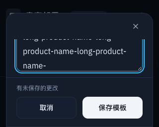 |
| 模板，320×600、根字号 200% | 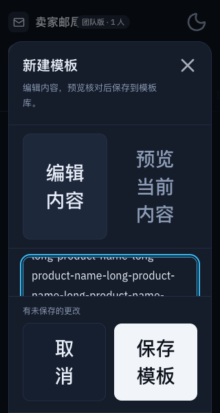 | 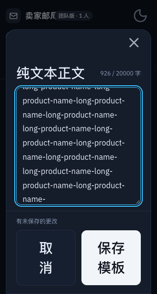 |
| 模板，820×360 横向短视口 | 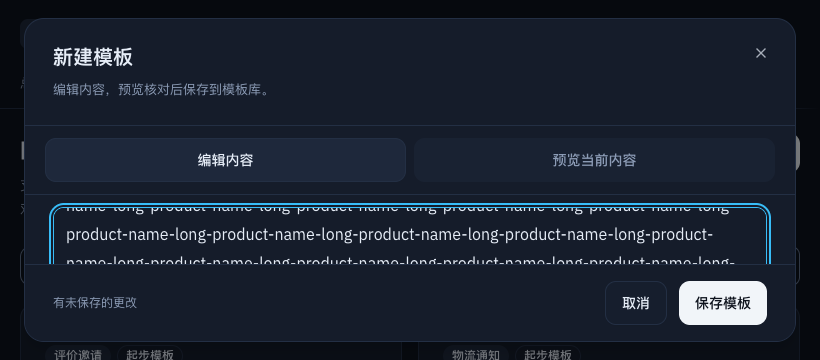 | 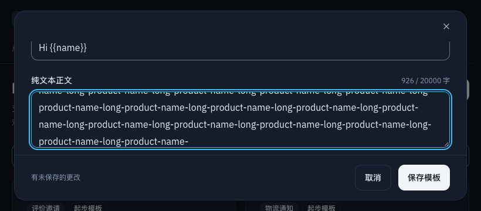 |
| 通道，390×844、根字号 200% |  | 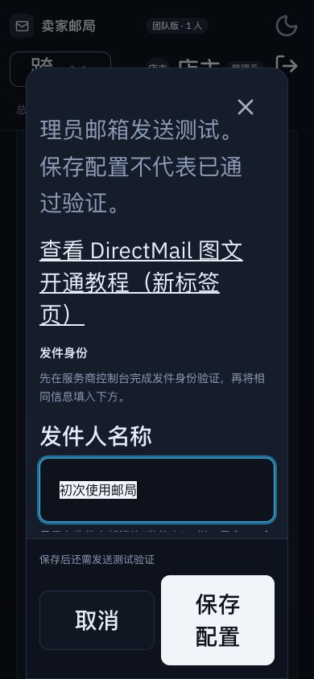 |
| 模板，1440×960 桌面 | 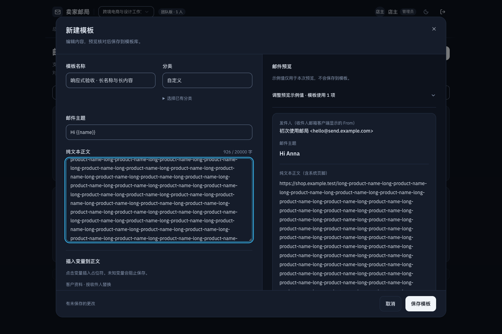 |  |
| 模板，390×844 手机预览 |  | 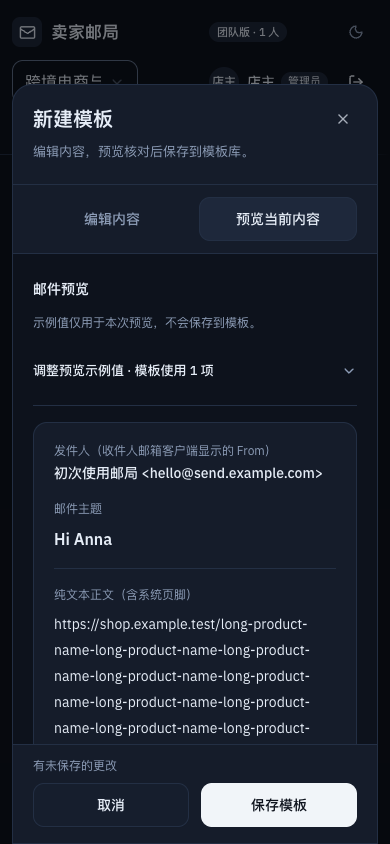 |
| 设置，320×600、根字号 200% | 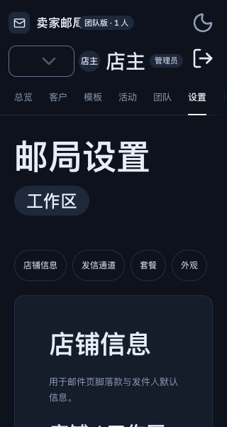 |  |
| WebKit 活动编辑器，320×600、根字号 200% | 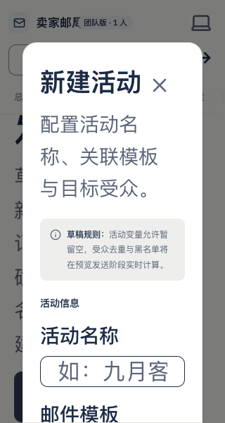 | 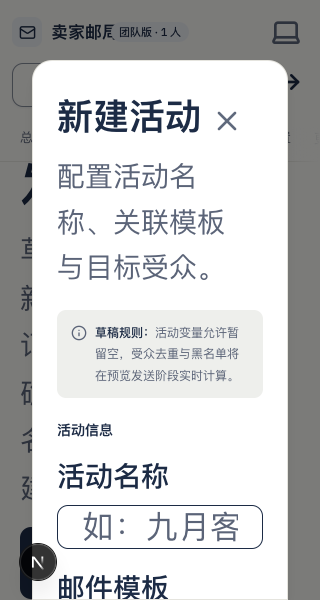 |

设置页首屏图片保持相同，下方长字段造成的 402px → 320px 宽度差异由计算记录证明；不将该首屏图当作缺陷细节截图。

已人工查看实际生成的桌面双栏、手机编辑 / 预览、短视口和放大通道截图；这属于渲染图像复核，不冒充手动浏览器、触控或读屏操作。完整计算尺寸、引擎版本、图片及源码指纹见 [evidence.json](images/responsive-a11y/evidence.json)。

## 核心流程与合理例外

- 模板：编辑 / 预览切换、长网址与变量、保存区、未保存取消和失败后输入保留，复用原有回归。正常桌面仍为双栏，常规手机仍为内容 / 预览切换；只有高度不足时合并标题滚动。
- 客户导入：复用原有预检、计数、确认、结果、返回修改、刷新 / 中断恢复回归。本轮只检查共享 Label 对字段及布局的影响，不改变解析、去重、订阅或恢复语义。
- 通道：配置长表单与恢复正常视口、保存失败保留、原有测试结果和手动核对回归均保留；不添加发信重试或修改测试幂等。回归发信只到本地夹具。
- 活动：新建、预览、名单确认、正式发送确认与权限限制复用默认回归；补充 WebKit 窄屏放大选择框断言，不创建真实发送任务。
- 原生单行选择框收起时允许省略长选项，展开仍保留完整选项；输入框内的长值可在控件内查看。普通标题、标签、段落和按钮采用自然换行。
- 导入结果表格、邮件预览及技术示例中已有必要的局部滚动保留；未通过隐藏页面溢出、禁用缩放或缩小文字掩盖问题。
- 不改新的 ARIA、键盘模型或读屏反馈。因滚动容器回流，原有滚动避让改为读取当前可滚动容器；没有删除焦点恢复、Escape、遮罩约束或离开保护。

## 验证矩阵与工程结果

| 检查 | 实际结果 |
| --- | --- |
| 旧 main 基线 | Chrome 113 个场景采集完成；运行时源码与基线提交一致。WebKit 原选择框的独立复现按预期失败，保留 254px / 259px 记录 |
| `EDM_RESPONSIVE_PHASE=after npm run test:e2e:responsive` | 15 项通过，0 跳过；三个引擎各 113 个截图场景，共 339 个；另有 132 个断点检查 |
| Chrome 156.0.8078.76 | 桌面 / 手机双主题，320 / 390 / 820 / 1440px、短视口、长内容、200% 根字号与文字间距覆盖 |
| Firefox 155.0 | 同上；滚动终点在字体与尺寸观察完成后验证 |
| Playwright WebKit 26.6 | 同上；包含原生选择框与长变量标签兼容性检查，不等同于真实 Safari |
| 原有针对性回归 | 模板编辑器、通道配置与弹窗回归共 17 项通过；完整默认回归再次覆盖最终源码 |
| 视觉人工复核 | 实际查看桌面双栏、手机编辑 / 预览、短视口及放大通道原始截图；16 张代表图随 PR 提交 |
| 无障碍自动扫描 / 专项键盘 / 读屏器 | 按用户最新范围不作为本轮验收；没有新增扫描依赖或生产包 |
| `npm run ci:verify` | 通过：lint、typecheck、format:check、222 项单元 / 数据库测试、生产构建、62 项 E2E；1 项默认条件跳过（无加密密钥场景，默认配置有测试密钥，未额外补跑此无关配置专项） |

专项首次运行需具备当前 Chrome，并执行 `npx playwright install firefox webkit` 安装其他测试引擎。浏览器矩阵位于独立的 `tests/responsive.config.ts`，默认 `playwright.config.ts` 和 GitHub CI 工作流均未改动。

本轮新测试曾暴露两类夹具时序问题：WebKit 过早填值被水合初值覆盖、Firefox 在尺寸观察回调结束前断言滚动终点。现等待客户端挂载、字体和实际滚动状态完成；未修改认证行为、删除业务断言、取消原有滚动避让或添加重试配置。最终整组 15 项通过，报告中 unexpected / flaky / skipped 均为 0。

## 未执行项与手动复验

本轮未操作实体 iPhone / Android、真实 Safari、原生 200% / 400% 浏览器缩放或实体软键盘；当前电脑工具限制见前文。没有线上账号、真实服务商、支付或客户数据验证。范围已收窄，因此不声称完成全站无障碍验收。

实体设备后续可按以下步骤复验：

1. 在真实手机上打开新建模板，填入长正文，切换预览；横屏并唤出 / 收起键盘，确认内容可滚动、关闭与保存可达。
2. 打开通道配置，依次查看底部字段；缩放或增大系统文字后检查标题能滚出，底部操作不盖住字段；只检查布局，不保存真实凭据或发送邮件。
3. 在桌面浏览器原生 200% / 400% 缩放下查看设置和活动选择框；普通文字应回流，选择框展开可查看完整选项；恢复缩放后布局回到原状态。

## 检测器与规范增量

最终只运行一次 impeccable 源码检测，返回 22 条既有建议：3 条品牌字体、7 条字号、7 条圆角、5 条颜色；对照本轮 diff，0 条命中新增或修改行。Fraunces 为用户要求保留的现有品牌字体，其他项是此前实现及设计侧车的尺度建议；本轮没有新增字号、颜色、圆角或忽略规则，没有重跑扫描清零，也没有把检测结果当作无障碍通过证据。

`DESIGN.md` 仅增量补充长标签 / 骨架回流与长弹窗的空间不足策略。上下文工具还提示 `.impeccable/design.json` 落后于规范；本轮未修复侧车漂移，可另行使用 impeccable `document` 刷新。
