# 全站视觉一致性优化与验收

日期：2026-10-31。范围为卖家邮局站点 UI；保留暖灰、深蓝、Fraunces / IBM Plex、明暗主题与既有业务流程。

## 基线与隔离

- 从已同步的 `origin/main@6a9fafa` 创建 `codex/visual-consistency-polish`。前序活动 #79、模板 #80、导入 #81、通道 #82–85、引导 #86–87 均已合并；没有混入其他开放分支或自动合并其他 PR。
- 初始工作区只有未跟踪 `.impeccable/`。既有文件保留，本轮仅新增经过检查的 `.impeccable/design.json` 作为设计规范扩展元数据。
- 首次修改产品 UI 前完成 128 个场景的基线采集。随后在基于同一提交的临时独立工作区重拍固定数据基线，统一日志数量、展示时间、账号、状态、主题、视口与滚动位置；旧工作区仅复制本轮测试夹具和采集脚本，采集时的产品源码仍是旧 main。
- 测试使用回环地址上的隔离认证夹具和 PGlite。展示的邮箱、域名、店铺和地址均为测试数据；未读取线上客户数据或真实发信凭据。

## 实际路由与组件清单

| 页面 / 路由 | 主要组件 | 本轮处理与检查 |
| --- | --- | --- |
| `/` → `/dashboard` 总览 | `AppShell`、`PreparationGuide`、指标卡、最近活动 | 共享页头、长名称、引导展开/收起、读取失败、角色限制；保留事实推导与完成条件 |
| `/contacts` 客户 | `Contacts`、`ListPagination`、客户/退订/归档弹窗 | 页头主要操作、可见筛选标签、语义订阅标签、空态与无结果、普通弹窗 |
| `/contacts/import` 导入 | `ContactImporter`、`ContactImportResults` | 共享控件影响、步骤、预检、确认、分批恢复、错误和下载；保留专用流程结构 |
| `/templates` 模板 | `Templates`、`TemplatePreview` | 页头、工具栏、卡片表面、操作层级、空态；保留网格布局 |
| `/templates` 内编辑器 | 独立编辑/预览区、未保存确认 | 共享 Dialog/字段影响；保留示例值边界、保存操作区与双栏/手机切换 |
| `/campaigns` 活动及弹窗详情 | `Campaigns`、预览、名单确认、发送确认、统计明细 | 页头/筛选复用、状态标签迁移；保留投递口径、正式发送保护、确认及详情布局 |
| `/campaigns/[id]/export` | CSV 导出 Route Handler | 无独立 UI，不做样式改动；既有回归检查权限和导出 |
| `/settings` 设置及套餐 | `SettingsForm`、`MemberProfileForm`、`ChannelSettings`、`BillingUpgrade` | 页头、普通内容卡、警告、错误关联、分区导航及禁用状态 |
| `/settings` 内通道/测试/结账弹窗 | `ChannelFormDialog`、`ChannelDetail`、`BillingCheckoutDialog` | 主题/字段/关闭目标影响；通道独立滚动、8px 间隔、手动恢复与支付行为保留 |
| `/team` 团队 | `TeamManager`、邀请及确认弹窗 | 页头、身份标签、席位提示；权限、邀请及成员行为不变 |
| `/help` 帮助 | `HelpGuide`、`DirectMailSetupGuide` | 页头、提示组件、目录与搜索清除点击区、减少动态效果；保留阅读结构及图解 |
| `/logs` 日志 | `ActivityLogs`、`ListPagination` | 页头、字段分组、无结果及权限空态；保留原筛选和保留期 |
| `/login`、`/register` | `AuthForm` | 共享字段、按钮、错误关联与焦点；删除重复品牌眉题 |
| `/forgot-password`、`/reset-password` | `AuthForm` | 相同字段和错误规范；找回/重置行为及回调不变 |
| `/invite/[token]` | `InviteAcceptance`、认证邀请页 | 窄容器、长工作区名、无效链接和按钮；邀请规则不变 |
| `/onboarding` | `InitializeForm` | 正常初始化与错误重试；不改自动初始化、幂等与退出逻辑 |
| `/disabled`、`/setup` | 系统状态页 | 共享字体、容器和控件影响；不修改部署配置或账号状态 |
| `/unsubscribe/[token]` | `UnsubscribeForm` | 窄容器、确认/成功/无效状态；保留收件人中英双语内容与幂等规则 |
| 404、全局错误与工作区 loading | `not-found`、`error`、`Skeleton` | 404 截图；错误/加载源码核对及既有异步回归；没有给业务页面新增状态机 |
| `/auth/callback`、其他 `/api/*` | Route Handler | 不承载可视 UI；仅通过原有认证、退订、支付等回归检查兼容性 |

## 审查结论

方法为两个互相隔离的评审：A 进行源码与独立浏览器设计判断，B 进行源码检测和浏览器计算样式检查。A 结束后才将 B 结果用于合成。并行浏览期间夹具会切换场景，数量差异没有被误判为业务缺陷。

### 设计评审

| 启发式 | 基线分数 / 4 | 主要依据 |
| --- | ---: | --- |
| 状态可见性 | 3 | 已有加载、异步结果和筛选状态，表现方式分散 |
| 贴近用户语言 | 3 | 使用客户、模板、名单等实际业务语言 |
| 用户控制 | 3 | 已有取消、未保存保护、归档恢复和手动重试 |
| 一致性与标准 | 2 | 同级页头、筛选、普通弹窗和触控尺寸分叉 |
| 错误预防 | 3 | 已有名单确认、发送、订阅和权限护栏 |
| 识别优于记忆 | 3 | 准备清单和上下文保留，跨页查找顺序不同 |
| 效率 | 2 | 重复同权按钮与分散的搜索位置影响扫描 |
| 简约与审美 | 3 | 品牌稳定，部分卡片留白叠加 |
| 错误恢复 | 3 | 输入保留、重试入口已有基础，提示视觉分散 |
| 帮助文档 | 3 | 可检索与深链完整，需统一提示和操作触达 |
| **合计** | **28 / 40** | 全部十项适用；这是设计判断，不是自动检测分数 |

技术审查基线为 13/20：可访问性 3、性能 3、主题 3、响应式 2、实现一致性 2。性能项仅检查源码、资源和动画方式，没有开展加载性能或线上性能测量。

### 优先问题及结果

| 级别 | 经确认的问题 | 处理 |
| --- | --- | --- |
| P1 | 窄屏“更多”菜单的键盘当前位置没有视觉高亮 | 补齐 `data-highlighted` 背景与焦点环；回归验证方向键、Escape 焦点恢复和 Enter 跳转 |
| P2 | 客户/模板/日志为 18px 页标题，活动为 24px，计数和主操作位置分散 | `PageHeader` 统一同级标题/计数/说明/操作，标题保持 24px / 1.4 |
| P2 | 搜索、筛选与写入操作混排 | `ListToolbar` / `FilterField` 统一查找顺序，主要操作移到页头；所有事件和 URL 参数保留 |
| P2 | 手机共享控件为 32–38px，普通弹窗关闭仅 16×16px | 窄屏或粗指针下共享目标至少 44×44px；图标保持原视觉尺寸，关闭目标统一 44px |
| P2 | 身份、分类、成功、注意、错误使用多套颜色规则 | `Notice`、Badge 语义变体与明暗变量统一；身份/分类改为中性，业务状态文字不变 |
| P2 | 普通卡片圆角/阴影/内边距分散，模板低频操作同权 | 普通卡片 14px 边框表面，去掉重复顶部留白；模板常用预览、编辑与低频复制/归档区分强调 |

品牌的安静、可信感和高风险步骤的说明予以保留。认知负担集中在跨页重新寻找搜索、客户工具区混合五项同层决策、模板卡重复四个近似按钮；本轮通过位置和轻重处理，没有为压低选项数而重构导航或减少必要操作。

### 检测器与人工判断

- 基线 CLI：`impeccable detect --json src/components src/features` 返回 `[]`，0 项。
- B 在四个代表页成功注入浏览器覆盖层，得到 3 次命中、2 个规则：`flat type hierarchy` 和 `nested cards`。前者与实际层级分散相符；后者没有精确定位为缺陷，设置中的功能预览容器保留。
- 操作型页面不机械追求检测器的 1.25 倍字号比；数据行、说明和任务标题按实际用途分层。
- 初次修改前已实看桌面/手机、明暗主题的代表页面及弹窗。最终检测和人工复核结果见后面的验证记录。覆盖层服务与临时标签均已清理，没有残留注入脚本。
- 共享实现完成时的一次源码扫描产生 60 条建议：46 条字号、14 条圆角，均为新增 DESIGN.md 后的尺度核对建议。逐类复核后补充 12/16/20px 的实际角色、9/12px 的次级形状，以及 11px 技术标识、17px 活动名、4px 进度条、6px 表格结果、8px 内嵌错误等局部例外。没有通过批量忽略或机械改值清零；扫描后未复跑，不能将其报告为“最终 0 项”。原始分类随 evidence.json 保留。

## 共享实现与迁移

| 共享模式 | 重复使用位置 | 移除或收敛的旧规则 |
| --- | --- | --- |
| `PageHeader` | 总览、客户、模板、活动、设置、团队、帮助、日志 | 删除 `.section-heading h1` 的旧尺度、活动页独立页头/计数/说明/操作样式和 welcome 样式 |
| `ListToolbar` / `FilterField` | 客户、模板、活动、日志 | 删除独立 list-search 与常规列表 36/38px 高度覆盖；活动只保留任务网格和搜索图标布局 |
| `Notice` | 地址提示、署名提示、套餐/席位、通道注意、帮助说明/警告 | 删除 `.notice-warning` 的浅/深硬编码覆盖，迁移重复 amber 提示容器 |
| 语义 Badge | 订阅、活动状态、通道验证 | 删除活动中覆盖全部 Badge 变体的局部状态 CSS；保留状态文本和原枚举 |
| 共享控件和 Dialog | 全部业务页、认证/邀请/退订/系统页 | 常规高度来自同一 control-height；显式保留 sm 密度和复杂编辑器布局 |
| `EmptyState` 变体 | 客户、模板、活动、日志与权限空态 | 无结果和权限受限采用合适图标，标题/说明/操作节奏共享 |

规范见 [DESIGN.md](../DESIGN.md)。元数据只提交 `.impeccable/design.json`，不提交其他本机 critique、日志、临时配置或完整截图目录。

## 保留的合理差异

- 客户/日志以密集记录为主，模板以内容网格为主，活动以状态和后续任务为主；不强制同一列数、卡片高度或操作数。
- 导入保留返回链接、步骤、预检与分批恢复；总览保留真实准备状态和推荐动作。
- 模板和通道长表单可保持桌面 44px 密度，专用编辑器保留 20px 圆角、独立滚动体与操作栏。通道滚动区和页脚之间的显式 8px 间隔没有改动。
- 登录、邀请、退订、部署设置及错误页继续使用窄容器；收件人退订文案保留中英双语。
- 普通正文、密集元数据、长帮助说明和步骤标题允许不同尺度；未将所有文字机械统一。

## 前后对照

以下图片为相同隔离数据、状态、主题、视口和位置的本地 Chrome 原始截图。完整场景指标和源码/图片指纹记录在 [evidence.json](images/visual-consistency/evidence.json)。代表图片随 PR 提交，未依赖本机临时路径。

| 场景 | 修改前 | 修改后 |
| --- | --- | --- |
| 客户，桌面浅色：页头/搜索筛选/计数 | 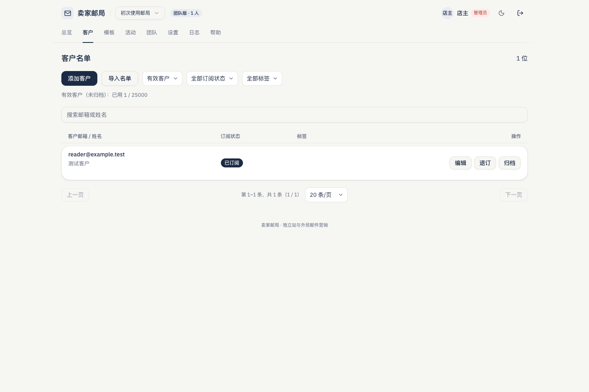 | 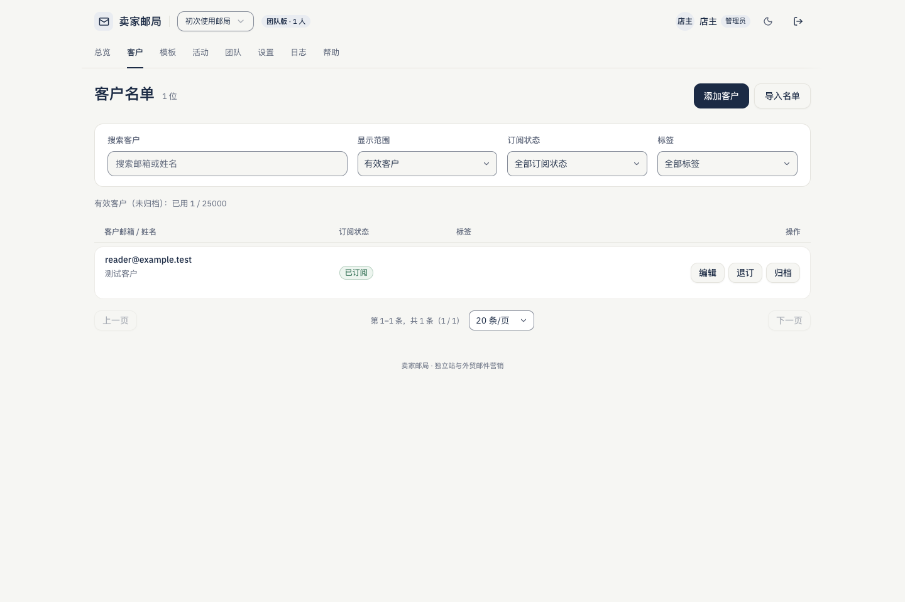 |
| 客户，手机深色：点击区与状态 | 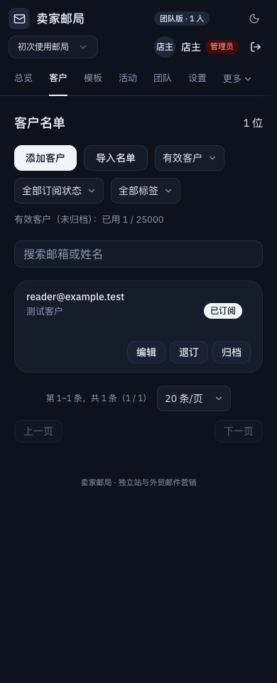 | 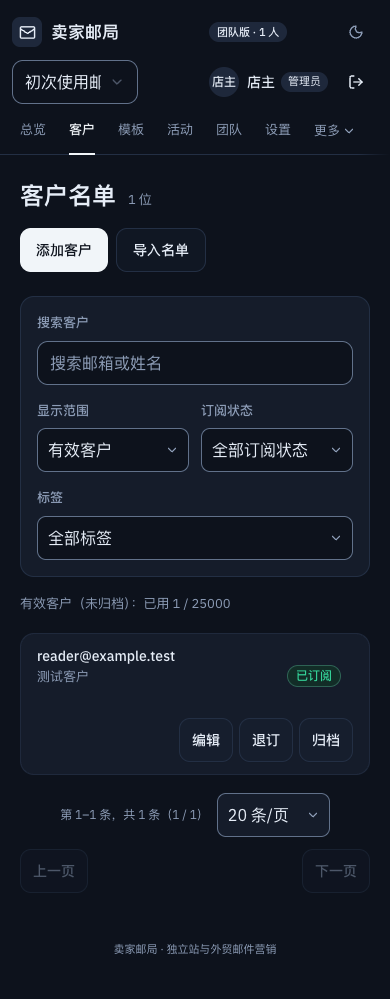 |
| 模板，桌面浅色：卡片和操作层级 | 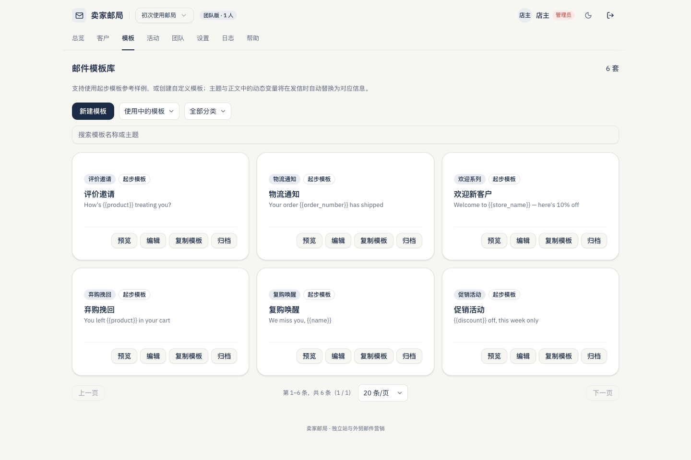 | 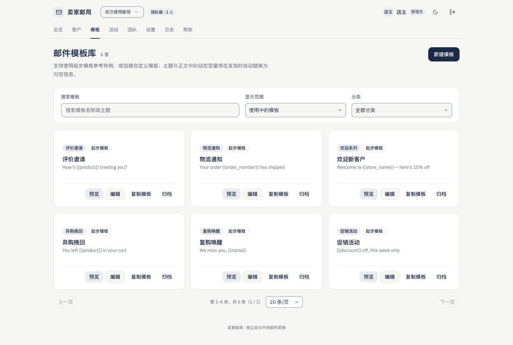 |
| 活动，手机深色：共同页头与专用任务布局 | 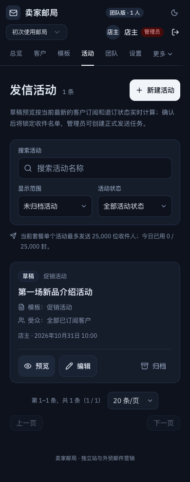 | 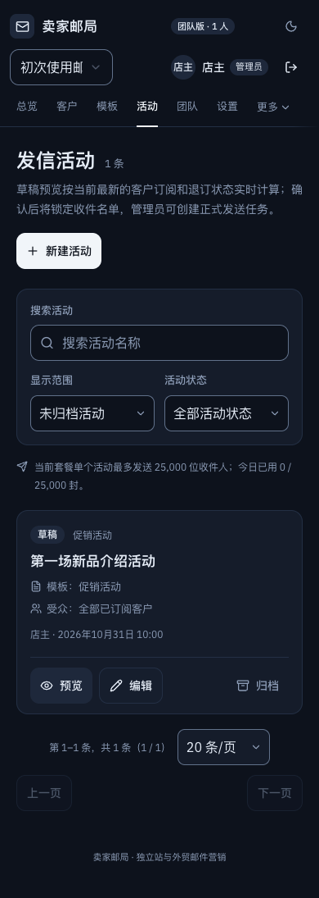 |
| 客户弹窗，手机浅色：标题/关闭/字段 | 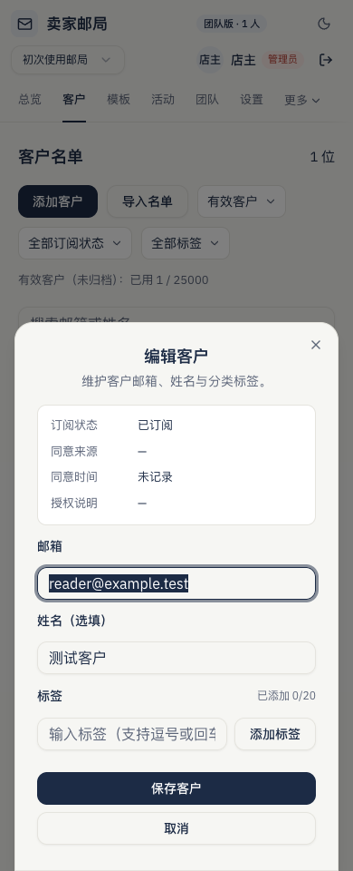 | 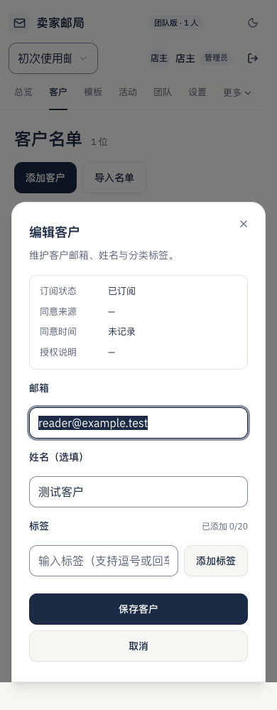 |
| 模板编辑器，手机深色：保留独立滚动与保存区 | 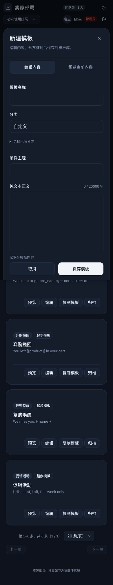 | 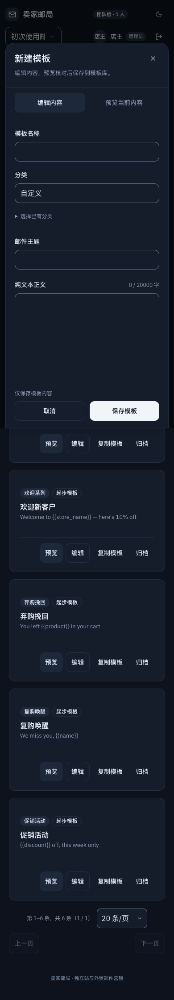 |
| 登录，手机浅色：表单与品牌层级 | 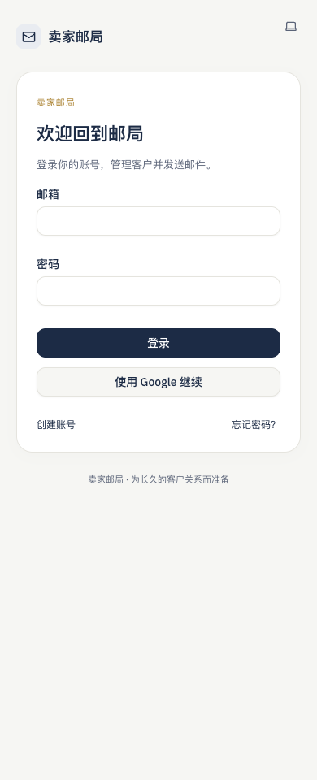 |  |
| 320px 短视口长名称：换行与导航 |  |  |

## 业务兼容边界

本轮没有修改认证实现、角色/权限判断、工作区/账号隔离、Server Actions、业务 model、导入解析器、订阅/去重/保护规则、模板保存参数、变量替换、示例值边界、通道验证/幂等/密钥处理、活动名单/发送/额度/套餐与统计口径。

没有数据库迁移、共享 Supabase 配置、Auth 触发器、aigc 或其他项目资源变更。测试夹具的展示时间和日志固定仅作用于本地隔离工作区，认证时钟保持真实。实际邮件 HTML、主题内容、纯文本渲染与收件人模板代码没有修改。

既有未保存离开保护、失败保留、异步互斥、手动恢复、深链、吸顶避让、焦点恢复和手机操作能力均通过原有流程回归核对。两项引导测试补充等待登录完成，避免导航抢先取消认证跳转；没有改动认证流程或删掉原断言。

## 验证记录

| 验证 | 实际结果 |
| --- | --- |
| 针对性回归：引导、套餐、模板审计、菜单、错误关联及弹窗标签 | 18 项通过；原有导入、通道、编辑器、键盘恢复回归也已执行，最终由完整 CI 再覆盖 |
| `EDM_CONSISTENCY_PHASE=after npm run ci:verify` | 通过：lint、typecheck、format:check、222 项单元/数据库测试、生产构建、61 项 E2E；1 项默认条件跳过 |
| `EDM_CHANNEL_NO_KEY=1 npx playwright test --config tests/channel-no-key.config.ts` | 默认跳过的无密钥场景独立补跑，1 项通过 |
| 旧 main 固定夹具视觉矩阵 | 3 项采集测试通过，129 个场景；其中首次 UI 修改前的初始基线为 128 个场景 |
| 最终开发模式视觉矩阵 | 129 个同数据对照场景，全部无页面横向溢出；16 张代表截图随 PR 提交 |
| 独立本地 production build + 7 项专项 | 构建及 7 项测试通过，再覆盖 129 个视觉场景；生产检查工作区与主工作区全部 157 个运行时源码文件逐一匹配 |
| 计算样式 | 390px 场景中共享按钮、输入、选择与关闭目标最小 44×44px；选取的共同文字最低对比度 5.44:1，常规字段边界最低 3.12:1 |

对比度样本覆盖页头、说明、筛选标签、Notice、Badge、字段错误及常规字段边界，排除不可见/禁用内容；这不等同于完整读屏器或全站 WCAG 认证。前后对照采用同为开发模式的捕获，production build 的结果独立记录，避免混合构建模式解释差异。

最终人工复核由主代理接手完成：本地 production build 的 Chrome 扩展浏览器，1440×960 浅色客户/模板/活动、客户弹窗和模板编辑器，390×960 深色活动/设置/团队/模板编辑器，以及“更多”菜单方向键高亮、Escape 与焦点恢复。确认普通弹窗靠左标题、字段关联、关闭区域、专用编辑器内容/预览切换与保存区正常。团队邀请标题与说明在手机上分行呈现，没有挤成短列。全过程未保存表单、发信、支付或退订，主题已恢复跟随系统、视口已复位、测试标签已关闭。

原生应用接口确认 Mac 锁定，无法可靠操作和核验浏览器原生 200% 缩放；已完成 CSS 200% 和根字号 200% 的模拟检查，未绕过锁屏。收尾子代理触及使用额度后由主代理完成复核，不将未完成的代理检查当作通过。

回归中修复了两类真实风险：筛选与编辑器的字段 ID 冲突，已改为独立 ID 并补充打开弹窗后的标签关联断言；200% 放大时顶栏超出 14px，已通过容器查询重排、收敛装饰和局部内边距解决，没有隐藏页面溢出。另将视觉采集器限定为可见界面，避免测量 Next.js 暂存的隐藏界面；几何、对比度与业务断言保留。

### 证据边界

- 源码检查、计算样式和截图均来自本地隔离环境；PGlite 验证不等同于远端数据库执行。
- 手动浏览器本轮可以访问本地服务，独立评审已经实际操作导航、主题、弹窗和键盘；没有绕过工具访问限制。
- 视口缩放、CSS/根字号放大和键盘收缩是浏览器模拟，不能描述为实体手机、真实软键盘或读屏器验收。
- 尚未进行浏览器原生 200% 缩放、真实 iPhone/Android、Safari/Firefox、VoiceOver、生产支付、生产发信或线上视觉验收；不从本地结果推断这些结论。
- PR 的 GitHub 工程验证和 Vercel 检查与本地 CI 分开核对。文档不将运行中或未完成的远端检查写成通过。
